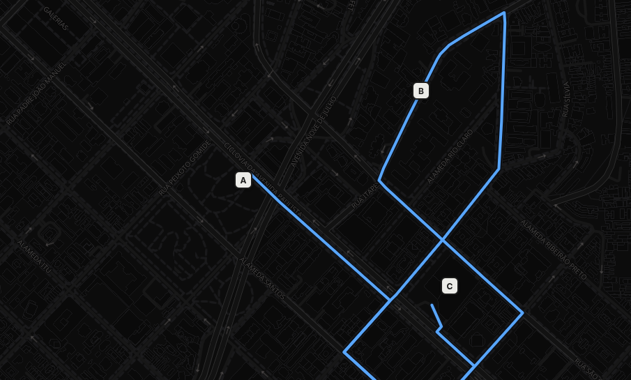

# gps-sim

[](https://github.com/olhy-services/gps-simulator/actions/workflows/ci.yml)
[](LICENSE)

Simulador de GPS em movimento para Android e simulador iOS.

Você marca o ponto **A**, o **B** e paradas no meio num mapa, e o aparelho conectado
"anda" por essa rota **pelas ruas**, como numa navegação real. Todo app do aparelho
recebe a posição: app de entrega, mapas, o seu app em desenvolvimento. Nada é
instalado no aparelho.



> **English:** gps-sim moves a device's GPS along a real road route (OSRM) picked on a
> map, at a chosen speed, with stops, time acceleration, ping-pong loops, accuracy and
> noise. Works with Android 12+ phones over adb (USB or Wi-Fi, nothing installed),
> Android emulators and iOS simulators. Scenarios are JSON files you can run headless
> in automated tests. The UI and docs are in Brazilian Portuguese.

## Para que serve

- Testar app de entregador, motorista ou corrida sem sair de casa.
- Ver o rastreio ao vivo do lado do cliente enquanto o "entregador" anda.
- Reproduzir o mesmo trajeto em testes automatizados (`gps-sim run`).
- Simular perda de sinal (túnel), paradas longas e GPS impreciso.

## Onde funciona

| Aparelho | Como a posição chega | Requisitos |
|---|---|---|
| **Android físico** (USB ou Wi-Fi) | `adb shell cmd location` cria provedores de teste `gps`, `network` e `fused` | Android 12+, Depuração USB ligada |
| **Emulador Android** | `adb emu geo fix` (GNSS emulado, não marcado como mock) | Emulador ligado |
| **Simulador iOS** | `xcrun simctl location` | macOS + Xcode 14+ |
| **iPhone físico** | Exporte o cenário em **GPX** e use no Xcode (Debug › Simulate Location) | A Apple não permite de outro jeito |

## Começo rápido

Requisitos: **Node 22+**, **pnpm** (`corepack enable`) e o **adb** (Android SDK
platform-tools; encontrado em `ANDROID_HOME` ou `~/Android/Sdk`, ou defina
`GPS_SIM_ADB`). Para iOS, o Xcode.

```bash
git clone https://github.com/olhy-services/gps-simulator.git
cd gps-simulator
pnpm install
pnpm dev              # abre http://127.0.0.1:4600 e recarrega ao salvar
```

Para uso diário, sem recarga automática:

```bash
pnpm build && pnpm start
```

1. Conecte o aparelho (ou ligue o emulador) e escolha ele em **Aparelho**.
2. Clique no mapa para marcar A, depois B (e mais pontos, se quiser).
3. Ajuste a velocidade e clique em **Iniciar**.
4. Abra o app no aparelho: ele já recebe a posição andando.
5. **Parar** devolve o GPS real.

## Como usar

- **Aparelho**: a lista atualiza sozinha a cada 3 s.
- **Sem cabo (Wi-Fi)**: com o cabo ligado uma vez, **Passar para Wi-Fi** faz o
  `adb tcpip` e conecta pelo IP. Sem cabo nenhum, abra **Conectar pelo Wi-Fi**: no
  celular, Opções do desenvolvedor › Depuração por Wi-Fi › Parear com código; cole
  IP:porta e o código, depois conecte no IP:porta da tela principal (é outra porta).
  Aparelhos anunciados na rede aparecem para um clique.
- **Pontos**: clique no mapa adiciona; arrastar move; **botão direito** coloca o
  aparelho parado ali na hora. A busca de endereço também adiciona ponto.
- **Parada** (segundos) em cada ponto: no primeiro é a espera antes de sair (ex.:
  retirada na loja); nos outros, o tempo parado ao chegar.
- **Caminho**: pelas ruas (carro/moto, bicicleta, a pé) ou linha reta.
- **Movimento**: velocidade, acelerar o tempo (até 20×), repetir (recomeçar ou ida e
  volta), precisão, ruído e intervalo de envio (padrão 250 ms = 4 posições/s).
  Mudanças valem na hora para a simulação em andamento.
- **Player**: pausar, voltar ao início, arrastar a barra para pular na rota, simular
  **perda de sinal** e **Parar**.
- **Cenários** são salvos como JSON em `scenarios/`. Dá para versionar e
  compartilhar com o time.
- **GPX**: exporta o cenário para usar no Xcode com iPhone físico.

### Formato do cenário

```json
{
  "version": 1,
  "name": "Exemplo: entrega pelo centro",
  "waypoints": [
    { "id": "a", "label": "Loja", "lat": -17.78674, "lng": -50.91462, "dwellSec": 10 },
    { "id": "b", "label": "Cliente", "lat": -17.78662, "lng": -50.96351, "dwellSec": 0 }
  ],
  "mode": "road",
  "profile": "car",
  "motion": { "speedKmh": 40, "timeScale": 1, "accuracyM": 8, "jitterM": 0, "tickMs": 250, "loop": "pingpong" }
}
```

`mode`: `road` (pelas ruas) ou `straight`. `profile`: `car`, `bike` ou `foot`.
`loop`: `off`, `restart` ou `pingpong`. O schema completo está em
`src/shared/schema.ts`.

## Linha de comando (testes automatizados)

```bash
pnpm sim devices                                   # aparelhos e se estão prontos
pnpm sim run scenarios/exemplo-entrega.json \
  --device <id> --scale 5                          # roda sem interface, 5× mais rápido
pnpm sim run <cenario.json> --speed 20 --loop off  # sobrescreve velocidade e repetição
pnpm sim reset <id>                                # devolve o GPS real se algo travou
pnpm start -- --port 4800 --no-open                # interface em outra porta
pnpm start -- --scenarios ./meus-cenarios          # outra pasta de cenários
```

`--device` é obrigatório quando há mais de um aparelho. Pela linha de comando o
`--scale` vai até 50× (na interface, até 20×). Para ter o comando `gps-sim`
no terminal: `pnpm link --global`.

| Variável | Para quê | Padrão |
|---|---|---|
| `GPS_SIM_ADB` | Caminho do `adb` | `ANDROID_HOME` ou `~/Android/Sdk` |
| `GPS_SIM_OSRM_URL` | Servidor OSRM próprio (o perfil vai no caminho: `/route/v1/{car,bike,foot}`) | `routing.openstreetmap.de` |
| `GPS_SIM_NOMINATIM_URL` | Servidor Nominatim próprio | `nominatim.openstreetmap.org` |

Em CI ou uso intenso, aponte para servidores próprios: os públicos têm política de uso
justo.

## Arquitetura

A página só desenha e manda comandos. O **relógio da simulação roda no servidor**:
a cada tick ele avança a distância percorrida na rota, para nos pontos pelo tempo
configurado, converte a distância em coordenada e entrega ao **driver** do aparelho
(Android físico, emulador ou simulador iOS). O estado volta para a página por SSE.

```
Navegador ──POST /api──▶ Servidor Node ── driver ──▶ aparelho
          ◀── SSE ─────  (engine, rotas,  ── OSRM / Nominatim
                          cenários)
```

```
src/
├── server/   cli, http, engine (+ teste), sessions, routing (OSRM), geocode
│             (Nominatim), scenarios, drivers/ (android, ios)
├── web/      App, MapView, RoutePanel, MotionPanel, Player, ScenarioPanel, gpx
└── shared/   schema.ts (contratos Zod), geo.ts
```

Detalhes do motor, dos drivers e de como adicionar um aparelho novo em
[docs/ARCHITECTURE.md](docs/ARCHITECTURE.md).

## Coisas para saber

- No Android físico a posição chega marcada como **mock** (`Location.isMock()`). Apps
  que bloqueiam localização falsa vão recusar. No emulador ela não é marcada.
- O `cmd location` não aceita velocidade nem rumo: no aparelho físico `speed` e
  `bearing` ficam vazios (o app calcula pela sequência de pontos). No emulador a
  velocidade vai junto.
- O app em teste recebe a posição no intervalo que **ele** pede ao sistema. Se pede a
  cada 5 s, verá saltos de 5 s mesmo com o simulador enviando 4×/s.
- Se o processo morrer sem limpar, o aparelho continua com GPS simulado até
  `pnpm sim reset <id>` (ou reiniciar o aparelho). Ctrl+C limpa sozinho.
- O servidor só escuta em `127.0.0.1` e recusa comandos vindos de outros sites. Veja
  [SECURITY.md](SECURITY.md).

## Problemas comuns

| Sintoma | O que fazer |
|---|---|
| Aparelho aparece indisponível | Android abaixo do 12 não tem `cmd location` de teste; use o emulador. |
| App ignora a posição | O app bloqueia mock location, ou pede posição raramente. |
| "Não foi possível calcular a rota" | Servidor OSRM público fora do ar ou sem rota entre os pontos. Tente linha reta ou `GPS_SIM_OSRM_URL`. |
| Celular ficou preso numa posição | `pnpm sim reset <id>`. |

## Contribuir

Veja [CONTRIBUTING.md](CONTRIBUTING.md). Antes de abrir um PR:
`pnpm typecheck && pnpm lint && pnpm test && pnpm build`.

## Créditos

- Rotas: [OSRM](https://project-osrm.org/) pelos servidores do
  [FOSSGIS](https://routing.openstreetmap.de/).
- Busca de endereços: [Nominatim](https://nominatim.org/).
- Mapa: [MapLibre GL JS](https://maplibre.org/) com estilos do [OpenFreeMap](https://openfreemap.org/).
- Dados de mapa © colaboradores do [OpenStreetMap](https://www.openstreetmap.org/copyright).

## Licença

[MIT](LICENSE) © Olhy Tecnologia e contribuidores.
